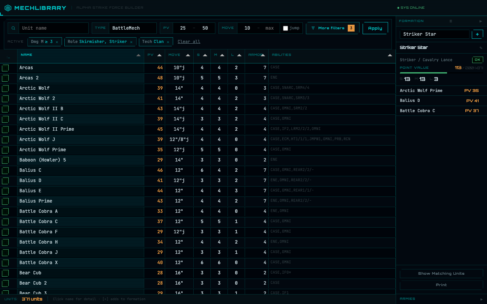

# Mech Library

Self-hosted searchable database and force builder for **BattleTech Alpha Strike**, fed from the
public unit data on the [Master Unit List](https://masterunitlist.battletech.com) (MUL).

Built because the filters on MUL are not flexible enough for serious force composition.



## Features

- **All Alpha Strike unit types** that matter for force building: BattleMechs, vehicles,
  Battle Armor, ProtoMechs, aerospace fighters and small craft.
- **Unit table** with combined filters: type, PV range, movement (incl. jump), TMM, damage at
  S/M/L, role, tech base, era, intro year and special abilities with values (`IF ≥ 1`, `FLK`, …),
  AND/OR mode.
- **Unit detail pages** with parsed ability breakdown and the MUL image.
- **Force builder:** armies and formations with live PV totals and rule checks for the Alpha
  Strike formation types (Battle Lance, Fire Support Lance, Heavy Battle Star, …).
- **Print view and PDF** with Alpha Strike style unit cards.
- **Login** with local accounts, Discord or Mattermost. Armies can be limited to a group (a
  Discord server, for example), so one instance can serve several gaming groups. See
  [`docs/AUTH.md`](docs/AUTH.md).

## Running with Docker

The quickest way to try it: Docker with Compose, nothing else.

```bash
git clone https://github.com/freisicht/mech-library.git && cd mech-library
cp .env.example .env            # set DB_PASS, and APP_DEBUG=false if others can reach it
docker compose up -d            # app on http://localhost:8080, MySQL in its own container
docker compose exec app bin/console user:add yourname
```

Migrations run on every start. The database, the MUL cache and the unit images live in Docker
volumes and survive `docker compose down` (not `down -v`). Set `APP_PORT` in `.env` for another
port. For a public instance put a reverse proxy with HTTPS in front of it.

Filling the database takes about a day (see below), so start the sync in the background and
follow its log:

```bash
docker compose exec -d app sh -c 'bin/console mul:sync --types=1,2,3,4,5,8,10 >> var/log/sync.log 2>&1'
docker compose exec app tail -f var/log/sync.log
docker compose exec app bin/console mul:images
```

If the container is recreated mid-sync, run the command again; it continues from the cache.

## Requirements (manual setup)

- PHP 8.3 or newer with `curl`, `json`, `mbstring`, `pdo_mysql`
- MySQL 8 (or compatible)
- Composer
- A web server that can serve `public/` as the document root of its own host
  (the app expects to live at `/`, not in a subdirectory)

## Manual setup

```bash
composer install
cp .env.example .env    # DB credentials, login provider
```

Create the database and apply the migrations. Perpl remembers what it has run in
`propel_migration`, so the second command is safe on every deploy:

```bash
mysql -e "CREATE DATABASE mech_library CHARACTER SET utf8mb4 COLLATE utf8mb4_unicode_ci"
vendor/bin/perpl migration:migrate
```

Fill it from [MUL](docs/MUL_API.md). `robots.txt` there asks for ten seconds between requests,
so a full sync of all 8,700 units takes about a day; run it in the background. Each unit page
is parsed once and cached under `data/raw/units/`, so an interrupted run continues where it
stopped and later runs only fetch what is new.

```bash
bin/console mul:sync --types=1,2,3,4,5,8,10   # Mechs, BA, vehicles, fighters, ProtoMechs, aerospace
bin/console mul:images                         # unit art into public/images/units/
```

Without `--types` the sync takes everything except BattleMechs (types 2, 3, 4, 5, 8, 10); the
type ids are listed in [`docs/MUL_API.md`](docs/MUL_API.md).

Create a login:

```bash
bin/console user:add yourname
```

Then point a virtual host at `public/`. For Apache, `public/.htaccess` handles the rewrites
(needs `AllowOverride All` and `mod_rewrite`).

To let your group log in with Discord or Mattermost instead of local accounts, set
`AUTH_PROVIDER` and register an OAuth app as described in [`docs/AUTH.md`](docs/AUTH.md).

## Development

```bash
composer test           # php-cs-fixer (dry run), PHPStan level 6, PHPUnit
```

The web tests need a MySQL database with the schema applied; they create and remove their own
fixture units. The GitHub Actions workflow in `.github/workflows/test.yml` shows the full setup.

Stack: Slim 4, Twig, [Perpl](https://packagist.org/packages/perplorm/perpl) (Propel2 fork),
Symfony Console, Guzzle, Tabulator and Pico CSS. No frontend build step.

## Documentation

- [`docs/MUL_API.md`](docs/MUL_API.md): where MUL data comes from (data snapshot and unit pages)
- [`docs/SCHEMA.md`](docs/SCHEMA.md): database schema and rationale
- [`docs/AUTH.md`](docs/AUTH.md): login providers and per-army group gating
- [`docs/PLAN.md`](docs/PLAN.md): roadmap, implementation notes and backlog
- [`docs/decisions/`](docs/decisions/): short architecture decision records
- [`CLAUDE.md`](CLAUDE.md) and [`docs/AGENT_WORKFLOW.md`](docs/AGENT_WORKFLOW.md): ground rules
  for AI coding agents. Most of this project was written with Claude Code.

## Please be nice to MUL

Keep the ten-second delay from MUL's `robots.txt`, keep the identifying User-Agent, and do not
sync more often than you need to. The cache in `data/raw/` exists so you rarely have to.

## Legal

Mech Library is an unofficial fan project. It is not affiliated with, endorsed by or sponsored
by Topps, Catalyst Game Labs or the Master Unit List. BattleTech, Alpha Strike and related marks
are trademarks of their respective owners.

This repository contains no unit data or images. Each installation fetches them from MUL for
its own use.

The code is released under the [MIT License](LICENSE). Bundled third-party assets keep their own
licenses, see [`THIRD_PARTY.md`](THIRD_PARTY.md).
